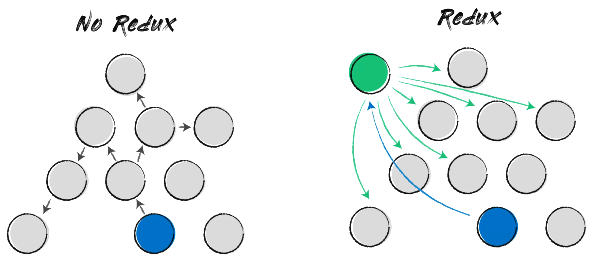
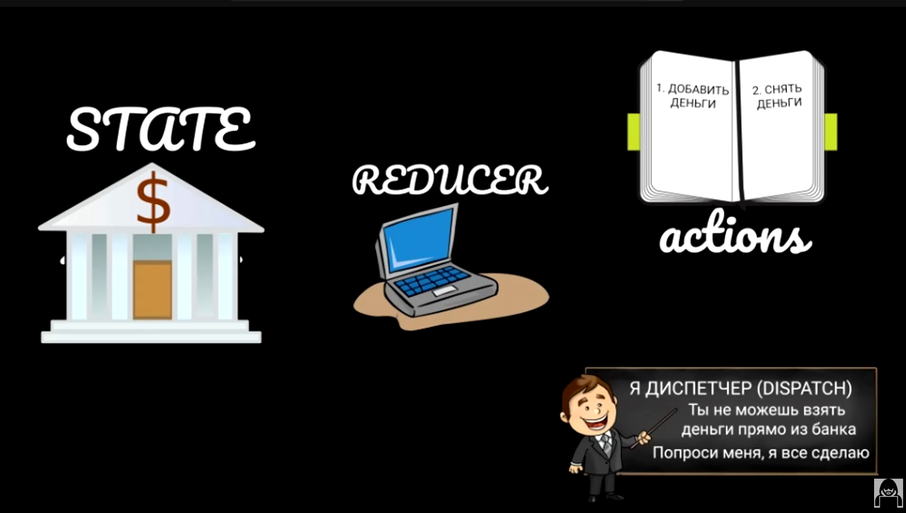

# INTRO

* Youtube [source](https://youtu.be/5Qtqzeh5FeM?si=8CELuDp3oFBHorcD)
* 

* NOTEs
  * for the above image use `img` tag and `width` attribjte with `value = 50%`
  * an example of full formm is
    * ``
  * for the below image use the `` form
* 

